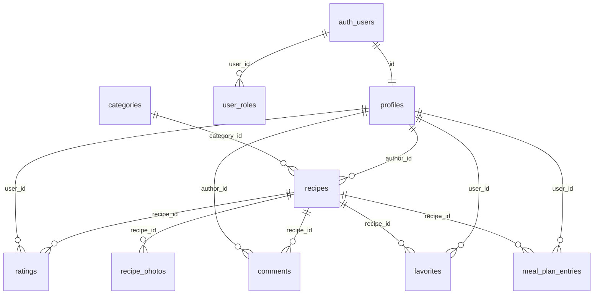

# Recipe Swap

A community recipe-sharing app. Users sign up, publish recipes with photos, rate and comment on each other's dishes, save favorites, and plan weekly meals. Admins moderate users, roles, categories and featured recipes.

## Features

- **Public recipe feed** — search, category filters, featured recipes, responsive card grid
- **Auth** — register / login / logout via Supabase Auth (email + password, JWT)
- **Recipes** — create, edit, delete; multi-photo upload with cover selection; ingredient checklist and numbered steps on the detail page
- **Community** — 5-star ratings, comments (edit/delete own, admins delete any), favorites
- **Meal planner** — weekly grid (Mon–Sun), 4 meal slots per day, recipe picker
- **Profile** — avatar upload, display name, bio, "My recipes" and "My favorites"
- **Admin panel** — user/role management, category CRUD, recipe moderation (feature/unfeature, delete)
- **Storage** — recipe photos and avatars in Supabase Storage with per-user folder policies
- **File download** — download recipe photos from the detail page

## Tech stack

| Layer | Technology |
|---|---|
| Frontend | Vanilla JavaScript (ES modules), HTML, CSS, Bootstrap 5 + Bootstrap Icons |
| Build | Node.js, npm, Vite (multi-page app — one HTML file per page) |
| Backend | Supabase — Postgres, Auth (JWT), Storage, Row-Level Security |
| Hosting | Netlify (static build from GitHub) |

No TypeScript, no frontend frameworks.

## Demo credentials

| Role | Email | Password |
|---|---|---|
| User | `demo@recipeswap.test` | `demo123` |
| Admin | `admin@recipeswap.test` | `admin123` |

The admin account has the `admin` role in `user_roles` and can access `/admin.html`.

## Local development

```bash
npm install
cp .env.example .env   # fill in your Supabase URL + anon key
npm run dev            # http://localhost:5173
npm run build          # production build → dist/
npm run preview        # preview the production build
```

### Environment variables

```
VITE_SUPABASE_URL=https://<project-ref>.supabase.co
VITE_SUPABASE_ANON_KEY=<anon or publishable key>
```

The anon/publishable key is safe to expose — all data access is protected by Row-Level Security.

### Supabase setup

1. Create a Supabase project.
2. Apply the migrations in `supabase/migrations/` (in filename order). With the CLI: `supabase link --project-ref <ref>` then `supabase db push`.
3. The migrations create all tables, RLS policies, grants, triggers, the `recipe_stats` view, seed categories, and the `recipe-photos` + `avatars` storage buckets.
4. To make a user an admin, insert a row: `insert into public.user_roles (user_id, role) values ('<auth-user-uuid>', 'admin');`

## Architecture

```
recipe-swap/
├── *.html                  # one page per screen (index, login, register,
│                           # recipe, recipe-edit, profile, meal-plan, admin)
├── src/
│   ├── pages/              # page entry modules (one per HTML file)
│   ├── services/           # Supabase data access: auth, recipes, engagement,
│   │                       # categories, storage, admin, supabase client
│   ├── components/         # navbar, recipe card, stars, confirm modal
│   ├── utils/              # DOM helpers, auth guards, date helpers
│   └── styles/main.css     # theme on top of Bootstrap
├── supabase/
│   ├── config.toml         # Supabase CLI config
│   └── migrations/         # SQL migrations (schema, RLS, storage buckets)
├── public/                 # static assets (favicon)
├── netlify.toml            # build config for Netlify
└── .github/copilot-instructions.md  # agent instructions & conventions
```

### Pages

| Page | File | Purpose |
|---|---|---|
| Feed | `index.html` | Browse/search/filter recipes, featured row |
| Login / Register | `login.html`, `register.html` | Supabase Auth |
| Password reset | `forgot-password.html`, `update-password.html` | Email reset link → new password |
| Recipe detail | `recipe.html?id=` | Photos, ingredients, steps, rating, comments, favorite, meal-plan add |
| Recipe editor | `recipe-edit.html` | Create/edit recipe + photo management |
| Profile | `profile.html` | Avatar, bio, my recipes, my favorites |
| Meal plan | `meal-plan.html` | Weekly planner |
| Admin | `admin.html` | Users/roles, categories, recipe moderation |

## Database schema



| Table | Purpose | Access |
|---|---|---|
| `profiles` | display_name, bio, avatar_path | public read; own update (name/bio/avatar only) |
| `user_roles` | role enum (`admin`, `user`) | own read; admin insert/delete (can't remove own admin) |
| `categories` | recipe categories + icon | public read; admin write |
| `recipes` | title, description, ingredients, instructions, times, servings, `is_featured` | public read; author or admin write; `is_featured` admin-only (trigger) |
| `recipe_photos` | storage_path, is_cover, position | public read; recipe author or admin write; one cover per recipe (partial unique index) |
| `ratings` | stars 1–5 per user per recipe | public read; own rows write |
| `comments` | body ≤1000 chars | public read; author write own; admin delete any |
| `favorites` | user ↔ recipe | private to owner |
| `meal_plan_entries` | user, recipe, date, meal_type | private to owner |
| `recipe_stats` (view) | avg_rating, rating_count, comment_count | public read (security_invoker) |

**Key security decisions:**

- Row-Level Security on every table; grants are explicit per migration (no default privileges).
- `is_admin()` is a `SECURITY DEFINER` function used inside policies.
- `handle_new_user` trigger creates the profile + `user` role on signup.
- `protect_recipe_columns` trigger prevents non-admins from setting `is_featured` and stops `author_id` reassignment.
- Storage objects are namespaced `<user_id>/...`; users can only write inside their own folder, admins can delete.
- Frontend role checks are UX only — RLS is authoritative.

## Deployment

Netlify builds the static `dist/` output. In the Netlify UI: **Add new site → Import from Git** → pick this repo, set build command `npm run build`, publish directory `dist`, and add the two `VITE_` environment variables. `netlify.toml` already contains this configuration.

Live demo: **https://recipe-swap.netlify.app/**
